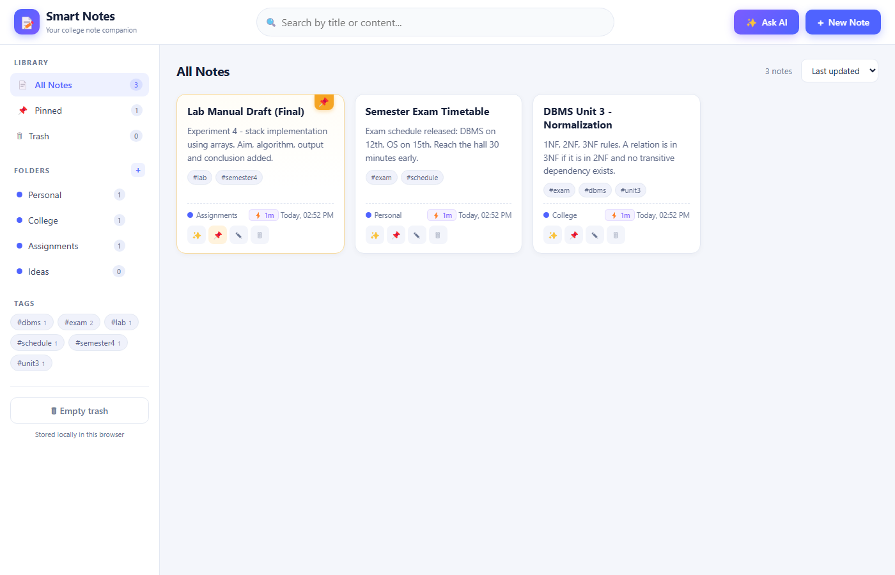

# Smart Notes — Smart Note-Taking Application

A complete, beginner-friendly note-taking web application built with plain
**HTML, CSS and JavaScript** — no frameworks, no build step, no internet
connection required. Notes are saved permanently in the browser's
`localStorage`.



---

## Features

| # | Feature | Where |
|---|---------|-------|
| 1 | **Create, edit and delete notes** | `+ New Note`, ✎ edit, 🗑 delete on each card |
| 2 | **Search by title or content** (also matches tags) | Search bar in the header |
| 3 | **Organise with folders and tags** | Sidebar → *Folders* and *Tags* |
| 4 | **Pin / unpin important notes** (pinned notes float to the top) | 📌 button on each card |
| 5 | **Persistent storage with `localStorage`** | Data survives refresh, new tabs and browser restart |
| 6 | **Responsive, modern UI** | Sidebar → horizontal bar, floating `+` button below 900 px |
| 7 | **Delete confirmation + empty states** | Confirm dialog for every destructive action, dedicated empty screens |
| 8 | **AI Note Copilot** | Note Modal → ✨ Title, 🏷️ Tags, 📝 Summarize, 🪄 Polish, ✅ Tasks, 📚 Study Guide |
| 9 | **AI Library Assistant** | Header → `✨ Ask AI` (`Ctrl+J`) for multi-note Q&A, library summaries & study quizzes |
| 10 | **Dual AI Engine** | Settings → Built-in Smart Local AI (100% offline) or Google Gemini / OpenAI cloud API |

Extra: trash with *Restore* / *Delete forever*, three sort orders, active-filter
pills, toast notifications, keyboard shortcuts (`Ctrl+K`, `Ctrl+N`, `Ctrl+J`, `Esc`), graceful handling of corrupted
storage data.

---

## Files

```
question1/
├── index.html          # page structure (header, sidebar, grid, dialogs)
├── style.css           # all styling, responsive breakpoints at 900 px / 560 px
├── script.js           # application logic (state, rendering, storage)
├── README.md           # this file
├── REPORT.md           # project report (objective, tests, results, conclusion)
├── screenshots/        # 10 real screenshots captured from the running app
└── tests/
    └── capture.mjs     # optional: headless-Chrome script that re-runs the
                        #    main flows and re-creates the screenshots
```

---

## How to run

### Option A — just open the file (simplest)
1. Double-click `index.html`.
2. The app opens in your browser and is ready to use.

### Option B — local web server (recommended)
Serving over `http://` matches how the app is tested and avoids any
`file://` restrictions.

```bash
# go to the project folder
cd question1

# Python 3
python -m http.server 8000
# or Node
npx serve .
```

Then open **http://127.0.0.1:8000/index.html**.

> Works in Chrome, Edge, Firefox and Safari (any browser that supports
> `localStorage`). Nothing to install, no dependencies.

---

## Keyboard shortcuts

| Shortcut | Action |
|----------|--------|
| `Ctrl` / `⌘ + K` | Focus the search box |
| `Ctrl` / `⌘ + N` | Open the **New Note** dialog |
| `Ctrl` / `⌘ + J` | Open the **AI Notes Assistant** |
| `Enter` (in dialogs) | Confirm the text prompt |
| `Esc` | Close the open dialog |

---

## How data is stored

Everything lives in `localStorage` under four keys:

| Key | Contents |
|-----|----------|
| `smartnotes.v1.notes` | All notes (title, content, folder, tags, pinned flag, timestamps, trash flag) |
| `smartnotes.v1.folders` | Folder names |
| `smartnotes.v1.ui` | Last selected view / folder / tag / sort order |
| `smartnotes.v1.ai_settings` | Selected AI engine (local/gemini/openai) & optional model/key |

* Clearing site data (or the three keys) resets the app.
* Corrupt or unreadable values are detected on load and reset to safe
  defaults instead of crashing the app.

---

## Tests and screenshots

The application was tested feature by feature (create, search, folder/tag
filter, pin, persistence after refresh, delete confirmation, trash, empty
states, shortcuts, responsive layout). The results are listed in
[`REPORT.md`](REPORT.md).

All screenshots in `screenshots/` are **real captures of the running
application** — nothing was mocked. They were produced by
`tests/capture.mjs`, which opens the app in a headless Chrome window,
performs the actual UI actions, verifies the resulting DOM state and then
takes the picture.

To regenerate them yourself:

```bash
# 1. start the static server (see Option B)
python -m http.server 8000

# 2. run the capture script (requires Google Chrome)
node tests/capture.mjs
```

| Screenshot | State shown |
|------------|-------------|
| `01-empty-state.png` | First run, no notes yet |
| `02-dashboard.png` | Dashboard with three notes, one pinned |
| `03-search-results.png` | Search by content ("stack") |
| `04-search-no-results.png` | No-match empty state with reset button |
| `05-folder-filter.png` | Notes filtered to the *College* folder |
| `06-new-note-modal.png` | New-note dialog |
| `07-delete-confirmation.png` | Delete confirmation dialog |
| `08-trash-view.png` | Trash with Restore / Delete forever |
| `09-trash-empty-state.png` | Empty trash state |
| `10-mobile-view.png` | Mobile layout (390 × 844) |

---

## Project report

See [`REPORT.md`](REPORT.md) for the objective, technologies used,
feature-wise test cases with results, limitations and conclusion.
