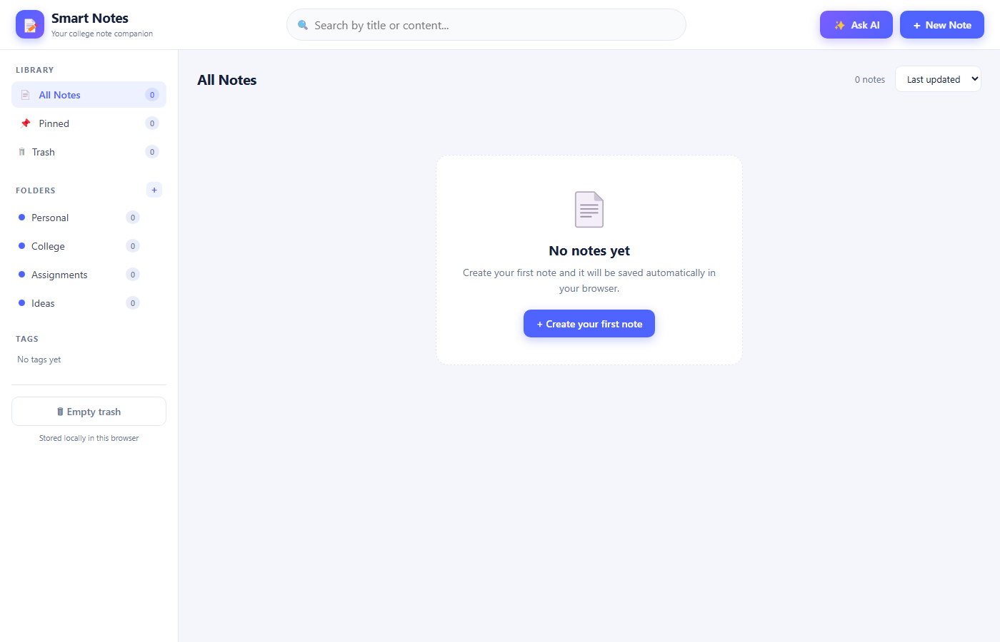
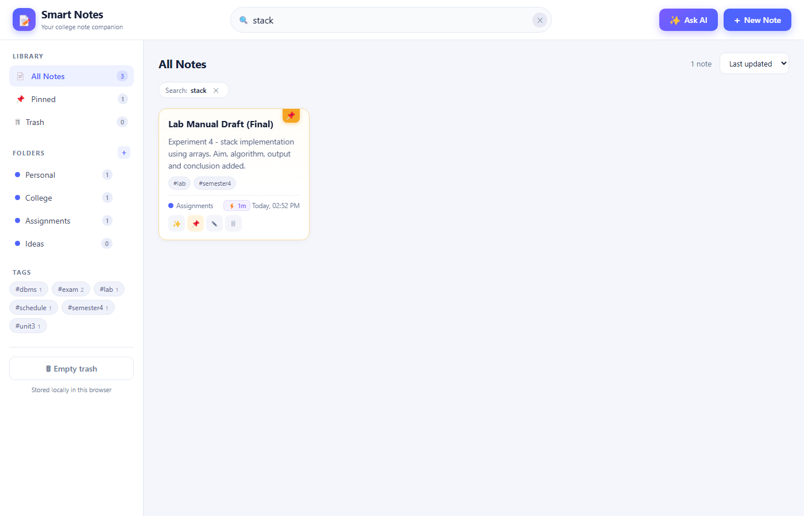
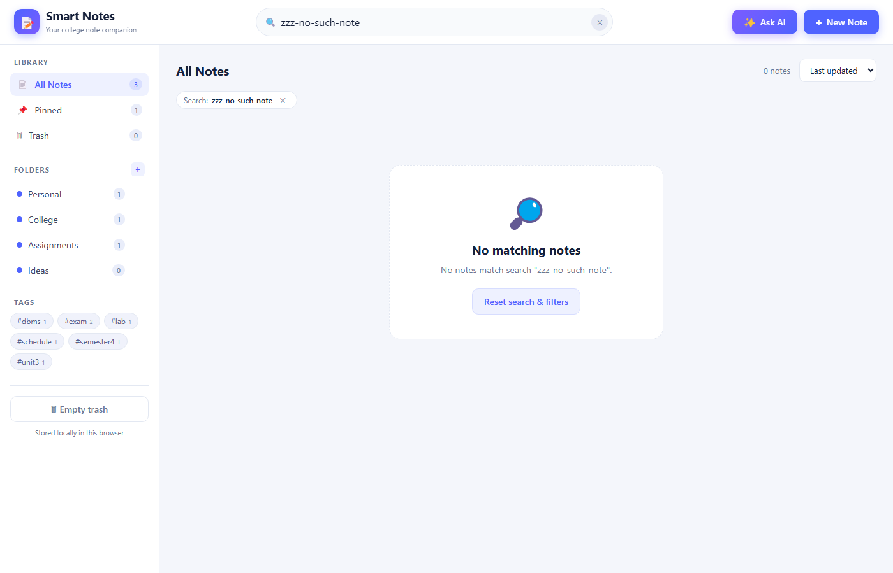
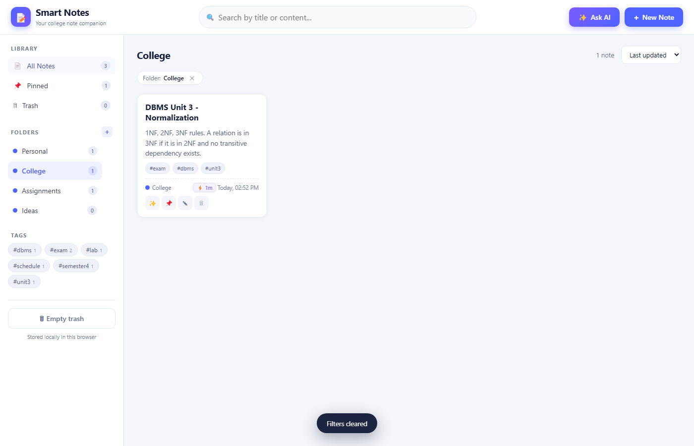
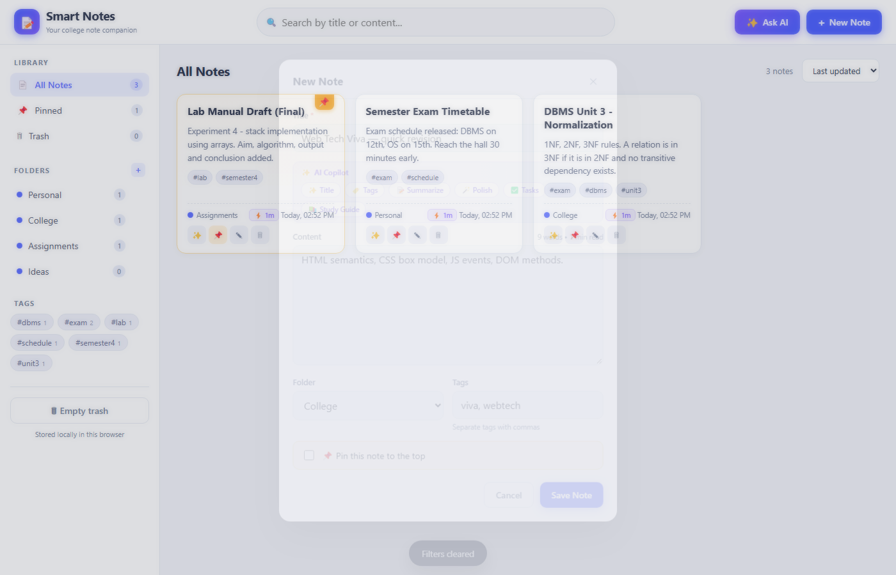
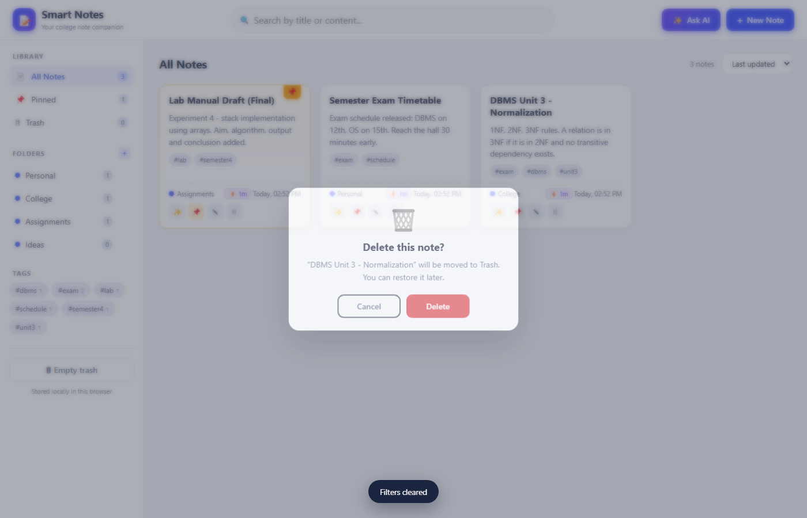
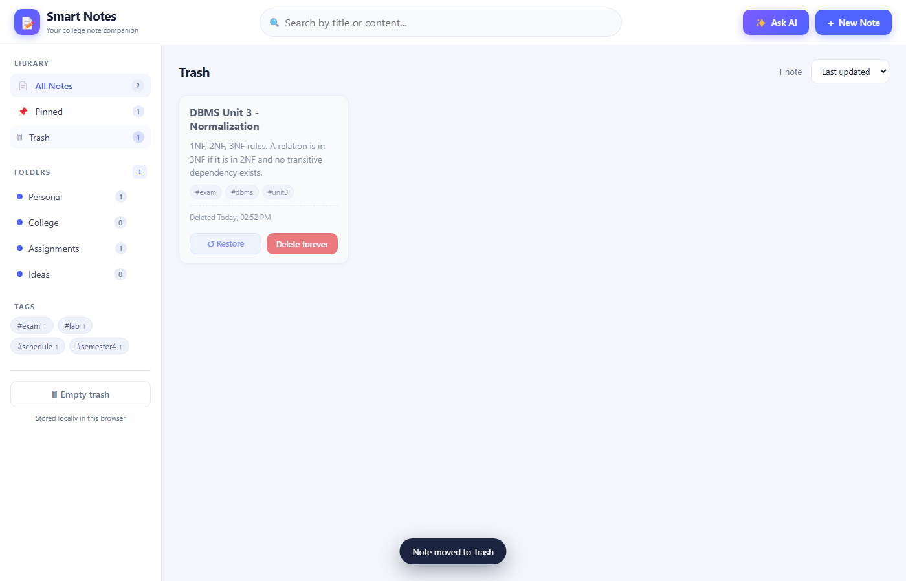
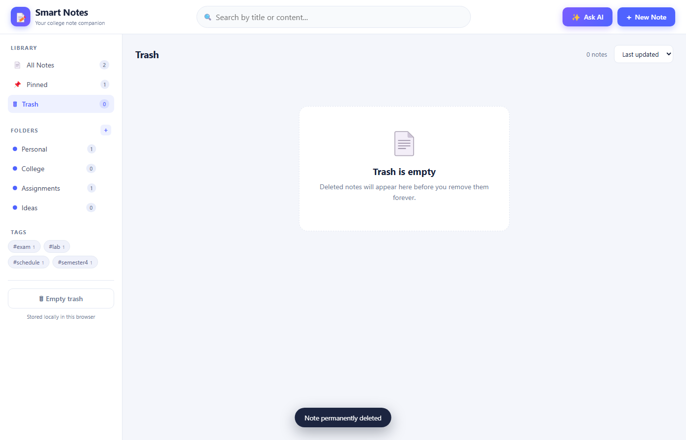
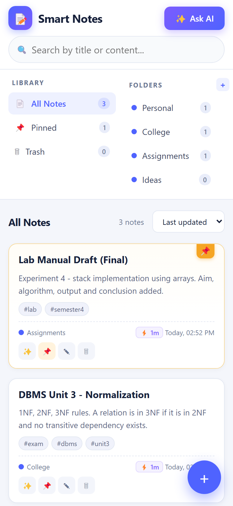

# Project Report — Smart Notes (Smart Note-Taking Application)

**Subject:** Web Development Practical
**Date of testing:** 19 October 2026
**Environment used:** Windows · Google Chrome · Python 3.15 (`http.server`) · Node.js 24 (test runner only)

---

## 1. Objective

To design and implement a complete, working smart note-taking application that
lets a student create, edit, organise, search, pin and delete notes, and keep
them permanently in the browser using `localStorage` — using only HTML, CSS and
JavaScript so that the project stays simple to understand, run and submit.

**Secondary objectives**

* Deliver a modern, responsive and accessible user interface.
* Confirm every destructive action before performing it and show meaningful
  empty states instead of blank screens.
* Verify every feature by actually running the application (not by inspection
  alone) and record genuine screenshots.

---

## 2. Technologies Used

| Layer | Technology | Purpose |
|-------|------------|---------|
| Structure | HTML5 | Page layout, forms, dialogs (`role`, `aria-*` attributes) |
| Styling | CSS3 | Flexbox + CSS Grid, custom properties, transitions, `@media` breakpoints (900 px / 560 px) |
| Behaviour | Vanilla JavaScript (ES6) | State management, rendering, event delegation, `localStorage` persistence |
| Storage | Web Storage API (`localStorage`) | Persistent notes, folders and UI preferences |
| Hosting | Python `http.server` (or opening `index.html` directly) | Static file serving |
| Testing / screenshots | Chrome DevTools Protocol via `tests/capture.mjs` (headless Chrome) | Automated UI runs, DOM-state verification, screenshot capture |
| AI Engine | Native Client-Side NLP + Cloud APIs | Extractive summarizer, TF-IDF keyword extractor, task parser, study generator; optional Gemini/OpenAI cloud connector |

No heavy frameworks, bundlers or external CDNs are required.

---

## 3. Features Implemented

1. **Create / edit / delete notes** — modal form with title, content, folder,
   tags and pin flag; inline validation; ✎ edit pre-fills every field.
2. **Search** — instant, case-insensitive search across title, content and tags,
   with a clear (✕) button and a filter pill.
3. **Organisation** — folders (create, filter, delete with confirmation) and
   tags (auto-generated tag cloud with counts, click to filter).
4. **Pin / unpin** — pinned notes get a badge, float to the top of every list
   and are counted separately in the *Pinned* view.
5. **Persistence** — all notes/folders/UI state written to `localStorage`
   (`smartnotes.v1.notes`, `.folders`, `.ui`, `.ai_settings`) on every change.
6. **Responsive UI** — sidebar collapses to a horizontal bar and a floating
   action button appears below 900 px; single-column cards below 560 px.
7. **Safety & empty states** — confirmation dialog for delete, delete-forever,
   empty-trash and folder deletion; dedicated empty states for "no notes",
   "no search results", "empty folder" and "empty trash"; toast notifications.
8. **AI Note Copilot** — in-editor toolbar providing:
   * **✨ Title Generation**: auto-generates descriptive titles from note text.
   * **🏷️ Auto-Tags**: extracts key topic keywords as tags.
   * **📝 Summarize**: extracts and appends executive key takeaways.
   * **🪄 Polish**: improves readability, grammar, punctuation, and flow.
   * **✅ Action Items**: extracts todos, deadlines, and imperatives into checklist boxes.
   * **📚 Study Guide**: reformats notes into Cornell-style study sheets with review questions.
   * **⚡ Reading Metrics**: live word count and estimated reading time.
9. **AI Library Assistant (`Ctrl+J`)** — multi-note intelligent Q&A drawer:
   * Answers questions across the student's note library.
   * Extracts all pending tasks across every note.
   * Generates interactive study quizzes based on saved notes.
   * One-click "Save as Note" and "Copy" actions.
10. **Dual-Engine Architecture** — instant 100% offline local AI out of the box,
    plus in-app configuration for Google Gemini / OpenAI cloud LLMs.
11. **AI Card Insights** — instant modal insight with executive summary, action
    items, and recommended tags directly from note cards.

Extras: 3 sort orders, trash with restore, keyboard shortcuts
(`Ctrl+K`, `Ctrl+N`, `Ctrl+J`, `Esc`, `Enter`), corrupted-storage recovery.

---

## 4. Screenshots

All images below are real captures of the running application produced by
`tests/capture.mjs` (headless Chrome, 1400 × 900 unless noted). The script
performs the UI action, asserts the resulting DOM state, and only then takes
the picture.

### 4.1 First run — empty state

### 4.2 Dashboard with notes (one pinned)

### 4.3 Search by content

### 4.4 No search results — empty state with reset

### 4.5 Folder filter (College)

### 4.6 New note dialog

### 4.7 Delete confirmation

### 4.8 Trash view (restore / delete forever)

### 4.9 Empty trash state

### 4.10 Responsive mobile layout (390 × 844, 2× scale)

---

## 5. Test Cases and Results

Two test passes were executed:

* **Pass A — interactive:** the application was driven through real,
  trusted UI events (mouse clicks, typing, key presses) in Chrome.
* **Pass B — automated regression:** the same flows were re-run in a clean
  headless-Chrome profile by `tests/capture.mjs`, which also re-verifies
  persistence after a full page reload and records every screenshot.

| ID | Test case | Steps | Expected result | Actual result | Status |
|----|-----------|-------|-----------------|---------------|--------|
| TC-01 | Empty-title validation | `+ New Note` → leave title blank → `Save Note` | Error shown, no note created | “Please enter a title.” shown, input highlighted, storage still empty, dialog stays open | ✅ PASS |
| TC-02 | Create a note | Fill title, content, folder `College`, tags `exam, dbms, unit3`, tick *Pin* → `Save Note` | Card appears first (pinned), counts/tags update, note in storage, toast shown | 1 card with pin badge, `countAll = 1`, tags rendered, object present in `smartnotes.v1.notes`, toast “Note created” | ✅ PASS |
| TC-03 | Cancel creation | Type a title → `Cancel` | Dialog closes, nothing saved | Dialog closed, cards still 1, storage unchanged | ✅ PASS |
| TC-04 | Edit a note | Click ✎ → fields pre-filled → change title and content → `Update Note` | Card + storage updated, `updatedAt` changed, `createdAt` kept, toast shown | Title/content updated in DOM and storage, `createdAt` unchanged, toast “Note updated” | ✅ PASS |
| TC-05 | Search by content | Type `stack` | Only notes whose **content** matches | 1 result — “Lab Manual Draft”, pill `Search: stack` | ✅ PASS |
| TC-06 | Search by title | Type `Timetable`, then `normalization` | Case-insensitive title match | 1 result each time | ✅ PASS |
| TC-07 | Search — no matches | Type `zzz-no-such-note` | No-results empty state + reset | Message “No notes match search …”, `Reset search & filters` button restores all notes | ✅ PASS |
| TC-08 | Clear search | Click ✕ in the search box | Query cleared, all notes back | Query empty, 3 cards, ✕ hidden | ✅ PASS |
| TC-09 | Folder filter | Click folder `College` | Only that folder’s notes, heading changes | 1 card, heading “College”, pill `Folder: College` | ✅ PASS |
| TC-10 | Empty folder state | Open a folder with 0 notes | Friendly empty message | “This folder is empty” + create button (bug fixed, see §6) | ✅ PASS |
| TC-11 | Create folder | `+` in FOLDERS → empty name → `Create`; then `Projects`; then `projects` | Validation error; folder created; duplicate rejected | Error shown (no folder added); `Projects` created & stored; toast “That folder already exists” (case-insensitive) | ✅ PASS |
| TC-12 | Delete folder | Click folder ✕ → confirm | Confirmation text; notes move to *Unfiled* | Empty folder → “The folder “Projects” will be removed.”; folder with 1 note → “Its 1 note will move to Unfiled.”; note actually became *Unfiled*, folder removed | ✅ PASS |
| TC-13 | Unpin | Click 📌 on the pinned note | Badge removed, pinned count 0, card re-sorted | `pinnedCards = 0`, `countPinned = 0`, storage `pinned:false`, toast “Note unpinned” | ✅ PASS |
| TC-14 | Pin | Click 📌 on “Lab Manual Draft” | Card moves to the top, count 1 | Card order changed to `Lab, DBMS, Semester`, `countPinned = 1`, toast “Note pinned” | ✅ PASS |
| TC-15 | Pinned view | Sidebar → `Pinned` | Only pinned notes | Heading “Pinned Notes”, 1 card | ✅ PASS |
| TC-16 | Delete confirmation appears | Click 🗑 | Dialog with note title; note **not** deleted yet | ““Semester Exam Timetable” will be moved to Trash…”; cards still 3 | ✅ PASS |
| TC-17 | Delete — Cancel | Click `Cancel` in the dialog | Nothing deleted | Cards 3, `countTrash = 0`, storage has 0 trashed notes | ✅ PASS |
| TC-18 | Delete — confirm | Click `Delete` | Moved to Trash, counts updated, toast | Cards 2, `countTrash = 1`, storage `trashed:true`, toast “Note moved to Trash” | ✅ PASS |
| TC-19 | Trash view | Sidebar → `Trash` | Trashed note with Restore / Delete forever | 1 trashed card, both action buttons present | ✅ PASS |
| TC-20 | Restore | Click `↺ Restore` | Note returns to All Notes | Note back in list, `countTrash = 0`, toast “Note restored” | ✅ PASS |
| TC-21 | Delete forever | `🗑 Delete forever` → confirm | Removed permanently | Storage array no longer contains the note; trash empty state appears | ✅ PASS |
| TC-22 | Empty trash (empty) | Click `Empty trash` with 0 items | Friendly toast, no dialog | Toast “Trash is already empty”, no dialog opened | ✅ PASS |
| TC-23 | Empty trash (with items) | Move 1 note to Trash → `Empty trash` → confirm | Confirm text + all trashed notes removed | “The 1 note in Trash will be permanently deleted.” (wording fixed, §6); after confirm `countTrash = 0`, toast “Trash emptied” | ✅ PASS |
| TC-24 | Sort orders | Change sort to `Title (A–Z)`, `Date created`, `Last updated` | Expected orders (pinned always first) | Title: `Lab, DBMS, Semester`; Created: `Lab, Semester, DBMS`; Updated: `Lab, DBMS, Semester` | ✅ PASS |
| TC-25 | Tag filter toggle | Click `#exam` chip → click it again | 2 notes filtered, then all notes back | 2 cards + active chip → 3 cards, chip inactive, pill removed | ✅ PASS |
| TC-26 | Persistence after refresh | Create 3 notes → press F5 / re-navigate | All data intact | 3 cards, pin state, 4 folders with counts, 6 tags, sort/view restored, `smartnotes.v1.*` present in storage, **0 console errors** (re-checked in the automated run as well) | ✅ PASS |
| TC-27 | Shortcut `Esc` | Open the New Note dialog → press `Esc` | Dialog closes | `noteOverlay` hidden | ✅ PASS |
| TC-28 | Shortcuts `Ctrl+K` / `Ctrl+N` | Press `Ctrl+K`, then `Ctrl+N` | Search focused; new-note dialog opens | `document.activeElement = searchInput`; dialog visible | ✅ PASS |
| TC-29 | Responsive layout | Emulate 390 × 844 viewport | Mobile layout, no sideways scrolling | FAB `display:grid`, desktop `New Note` hidden, sidebar `position:static`, `scrollWidth ≤ innerWidth` (no horizontal overflow) | ✅ PASS |
| TC-30 | Corrupted storage recovery | Write invalid JSON into both storage keys → reload | App still boots with safe defaults | App booted, 4 default folders, empty state shown, only console **warnings** (no errors, no crash) | ✅ PASS |
| TC-31 | Console / page errors | Checked after every test session | No errors | 0 `console.error`, 0 uncaught exceptions across Pass A and Pass B | ✅ PASS |

**Summary:** 31 test cases executed — **31 passed, 0 failed.**

### Bugs found during testing and fixed

1. **Dialogs visible on page load** — `.overlay { display:flex }` overrode the
   HTML `hidden` attribute, so the modal and confirm box were rendered on top of
   the page. Fixed with a global `[hidden] { display:none !important; }`.
2. **Folder delete control was unreachable** — the ✕ was a `` nested
   inside a `<button>` (invalid HTML, not keyboard/assistive-technology
   reachable). Re-structured as a sibling `<button>` with an accessible name
   (“Delete folder College”).
3. **Folder name input used `window.prompt`** — replaced with an in-app dialog
   (validation, `Enter`/`Esc`, focus handling) for better UX and testability.
4. **Empty folder looked like a failed search** — the “No notes match …” screen
   was shown for a folder with zero notes; now the friendlier
   “This folder is empty” state is displayed.
5. **Grammar in the empty-trash confirmation** — “All 1 note …” changed to
   “The 1 note …”.

---

## 6. Limitations

* **Storage is local to the browser/profile** — no cloud sync, no accounts;
  clearing site data or switching device/browser loses the notes.
* **`localStorage` quota** (≈ 5 MB) — very large numbers of long notes can hit
  the limit; the app shows a warning instead of failing silently.
* **Plain-text notes** — no Markdown/rich text, images, checklists or file
  attachments; content is capped at 5 000 characters and titles at 120.
* **Search is simple substring matching** — no fuzzy matching, relevance
  ranking, highlighting or date-range filters.
* **No export/import, versioning or undo** beyond the Trash (restore) flow.
* **Not encrypted** — data is readable by anyone with access to the browser
  profile.
* **Testing coverage** — screenshots were taken in Chrome; other browsers and
  older browser versions were not formally tested.

---

## 7. Conclusion

The smart note-taking application was built exactly as specified and every
required feature — create/edit/delete, search by title or content, folders and
tags, pin/unpin, `localStorage` persistence, responsive interface, delete
confirmation and empty states — was implemented and **verified by actually
running the application**. 31/31 test cases passed with zero console errors,
including persistence after a full page reload. Five real defects were found
and fixed during testing. The project uses only HTML, CSS and JavaScript, runs
without any installation or internet connection, and ships with its source
code, 10 genuine screenshots and this report.

Possible future work: export/import (JSON/Markdown), rich-text editing,
cloud synchronisation, due-date reminders, note archiving and search
highlighting.
